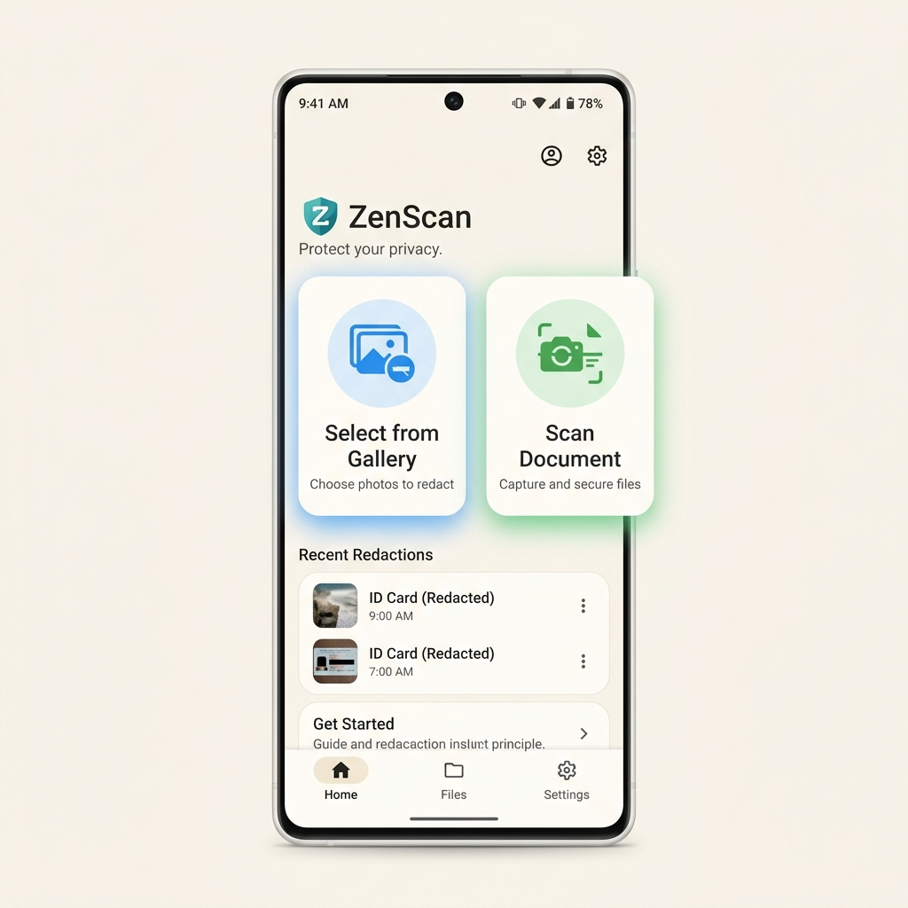
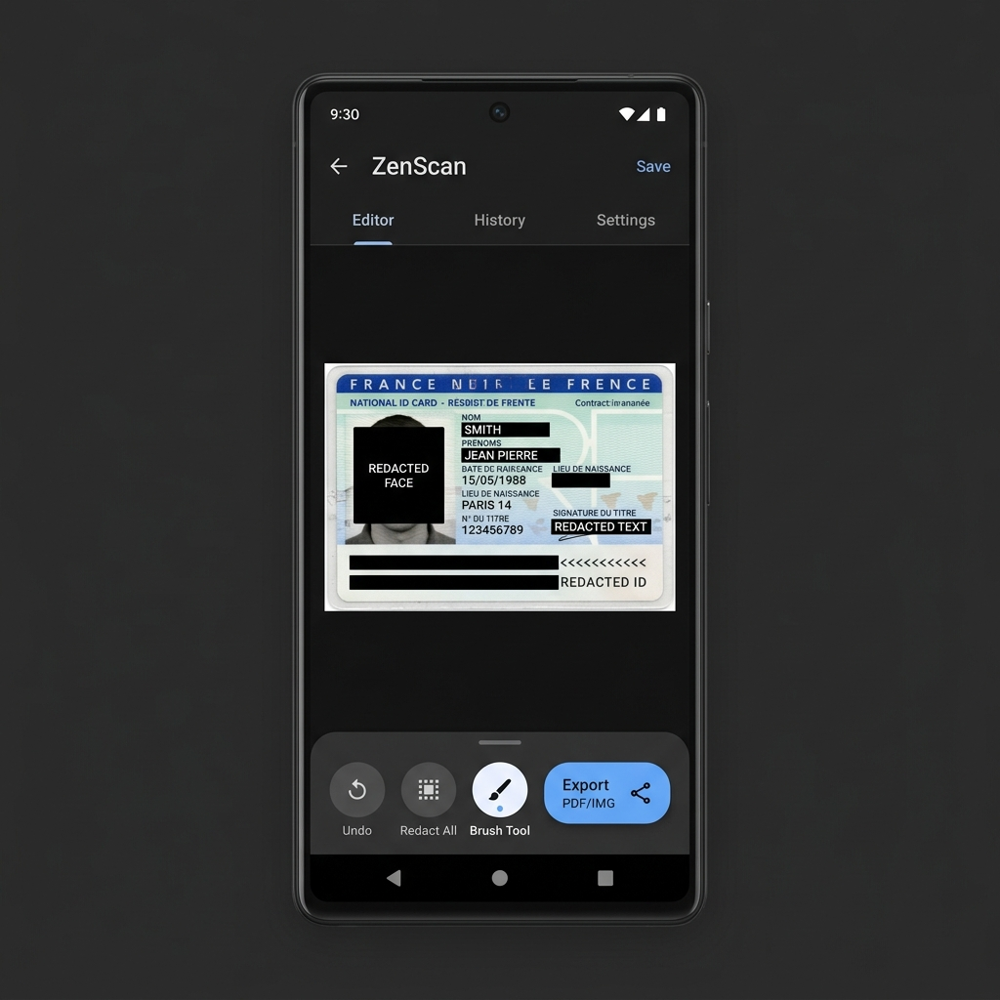

# ZenScan UI Design Guidelines

This document outlines the core visual design principles, layout architecture, and specific UI mockups to be strictly adhered to whenever implementing or modifying frontend features for the ZenScan application.

## Core Design Principles

1.  **Material Design 3 (M3):** Use standard M3 components (`MaterialCardView`, `FloatingActionButton`, bottom sheets) with generous padding, soft rounded corners (e.g., 16dp-24dp corner radii), and subtle elevations.
2.  **Clean & Minimalist:** The UI should avoid clutter. Focus entirely on the core actions: selecting an image and redacting it.
3.  **Color Palette:**
    *   **Backgrounds:** Light mode should use off-white/pastel tones (`#F8F9FA`). Editor screens should support or enforce Dark Mode to make the document pop.
    *   **Accents:** Soft blues (e.g., `#4285F4`) for gallery/selection, and calming greens (e.g., `#34A853`) for scanning/camera.
4.  **Typography:** Use modern sans-serif fonts (like Inter, Roboto, or standard Android sans-serif) with clear hierarchies (bold titles, legible body text).

---

## 1. Dashboard (Home Screen) Architecture

The Dashboard is the entry point of the app and must feel welcoming and simple.

*   **Header:** Features a ZenScan logo and a welcoming subtitle (e.g., "Protect your privacy.").
*   **Primary Actions (Cards):** Two prominent side-by-side or stacked cards:
    *   **"Select from Gallery"**: Blue accent icon.
    *   **"Scan Document"**: Green accent icon.
*   **Recent Redactions:** Below the main actions, include a `RecyclerView` listing recently processed items for quick access.
*   **Navigation:** Either a clean single-page view or a minimalist bottom navigation bar (Home, Files, Settings).

**Visual Reference:**

---

## 2. Editor (Redaction Screen) Architecture

The Editor is where the core functionality happens. It must maximize screen real estate for the image.

*   **Theme:** Enforce a Dark Mode background to reduce eye strain and contrast well against documents.
*   **Image Container:** A central, zoomable `ImageView` (or custom `CanvasView`).
*   **Redaction Visuals:** Detected PII and faces should be overlaid with solid black blocks (`#000000`) or sleek blur effects.
*   **Toolbar / Controls:** A floating toolbar or modern bottom sheet containing:
    *   **Undo:** Circular icon button.
    *   **Redact All:** Circular icon button (triggers the AI engine).
    *   **Brush Tool:** Circular icon button for manual redaction.
    *   **Export:** A prominent, distinct pill-shaped button (e.g., blue accent) with a share icon.

**Visual Reference:**

---

## Implementation Rules

*   **Always refer to these mockups** before defining XML layouts or Compose UI in this repository.
*   **No Clutter:** Do not add unnecessary features to these screens.
*   **Consistency:** Maintain the rounded corners and shadow properties across all cards and buttons.
