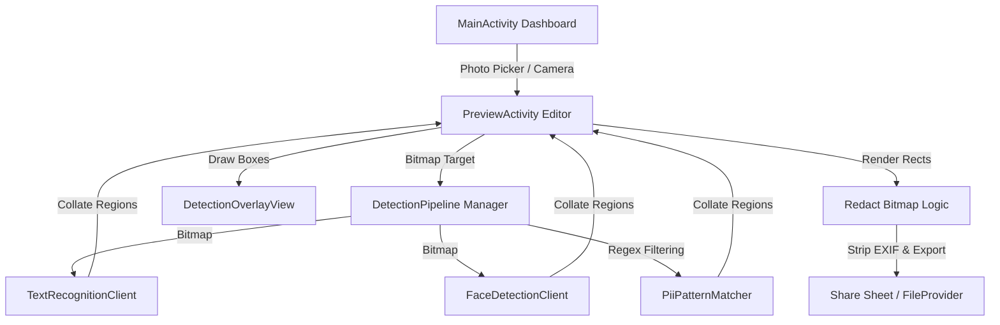

# ZenScan Project Context

> [!IMPORTANT]
> **DEVELOPER AGENT ACTION REQUIRED:**
> - **Startup Protocol**: Read this file first before taking any action. Align your focus with the **Active Task** and **Roadmap** sections. Adhere strictly to the **Development Guidelines**.
> - **Feature Completion Protocol**: Once a task or feature is finished, immediately update this file before ending your turn. Update the status of features, document changes in the **Session Audit & Change Log**, and advance the **Active Task** section.

---

## 1. Project Identity

**ZenScan** is a modern, privacy-first Android utility application designed to protect user privacy. It enables users to easily redact sensitive information (Personal Identifiable Information or PII, credit card numbers, faces) and clean EXIF metadata from screenshots, documents, and photos before sharing.

### Core Value Proposition
- **On-Device Only**: Zero networks. All scanning, face detection, text recognition, and redaction happen locally using Google ML Kit.
- **Secure Export**: Metadata is stripped and redacted pixels are rendered directly into new compression targets, ensuring no original details can be recovered.
- **Frictionless UI**: Modern Material 3 dashboard, visual photo picking, instant scan results with interactive overlay toggle, and quick share sheet integration.

---

## 2. System Architecture & Tech Stack

### Key Package Directory & Absolute Path Links
- **Core Activities**:
  - [MainActivity.kt](file:///home/sanjeev/AndroidStudioProjects/Realsanjeev/app/src/main/java/com/example/zenscan/MainActivity.kt) - Entry point; coordinates photo picking and dashboard clicks.
  - [PreviewActivity.kt](file:///home/sanjeev/AndroidStudioProjects/Realsanjeev/app/src/main/java/com/example/zenscan/PreviewActivity.kt) - The main workspace; handles loaded image lifecycle, undo stack, rendering, and export.
- **AI Detection Engine (`/detection`)**:
  - [DetectionPipeline.kt](file:///home/sanjeev/AndroidStudioProjects/Realsanjeev/app/src/main/java/com/example/zenscan/detection/DetectionPipeline.kt) - Coordinates OCR and face detection engines concurrently.
  - [FaceDetectionClient.kt](file:///home/sanjeev/AndroidStudioProjects/Realsanjeev/app/src/main/java/com/example/zenscan/detection/FaceDetectionClient.kt) - Wraps Google ML Kit Face Detector.
  - [TextRecognitionClient.kt](file:///home/sanjeev/AndroidStudioProjects/Realsanjeev/app/src/main/java/com/example/zenscan/detection/TextRecognitionClient.kt) - Wraps Google ML Kit Text Recognizer.
  - [PiiPatternMatcher.kt](file:///home/sanjeev/AndroidStudioProjects/Realsanjeev/app/src/main/java/com/example/zenscan/detection/PiiPatternMatcher.kt) - Regex rules and Luhn algorithm validations for PII (emails, cards, phones).
- **Models**:
  - [DetectedRegion.kt](file:///home/sanjeev/AndroidStudioProjects/Realsanjeev/app/src/main/java/com/example/zenscan/model/DetectedRegion.kt) - Houses data classes for found text blocks and faces.
- **Views**:
  - [DetectionOverlayView.kt](file:///home/sanjeev/AndroidStudioProjects/Realsanjeev/app/src/main/java/com/example/zenscan/view/DetectionOverlayView.kt) - A high-performance custom Canvas view displaying bounding boxes with modern animations and badges.

### Tech Stack Specifications
- **Framework & UI**: XML Layouts using Android Material 3 and ViewBinding.
- **Jetpack Libraries**: lifecycle-runtime-ktx, lifecycle-viewmodel-ktx, activity-ktx, navigation.
- **AI Engines**: Google ML Kit (Text & Face).
- **Image Loading**: Coil (Coil image loading engine for Kotlin/Android).
- **Asynchrony**: Kotlin Coroutines (Dispatchers.Default for AI processing, Dispatchers.IO for storage/image loads, Dispatchers.Main for UI updates).

---

## 3. Development Guidelines & Platform Rules

To maintain high standards, developer agents must follow these absolute rules:

### A. Android Jetpack & Styling Best Practices
- **ViewBinding**: Always inflate and bind layouts using native ViewBinding. Never call `findViewById` directly.
- **Material 3 Design**: Use M3 components (e.g. `MaterialButton`, modern `Toolbar`, rounded badges). Prefer curated, premium HSL tailored colors (like Indigo, Emerald, Rose-red) over primary default values.
- **Resource Extraction**: Maintain clean string, color, and dimension values in `res/values/` files (e.g., `strings.xml`, `colors.xml`). Do not hardcode dimensions or strings in Kotlin or XML files.

### B. On-Device AI & Privacy Architecture
- **Strict Privacy**: Under no circumstances should user photos or PII leave the device. Do not integrate network dependencies or external telemetry targets unless authorized by the project plan.
- **Thread Management**: AI operations (ML Kit calls, pattern regex matches) and bitmap modifications (redaction rendering, metadata stripping) must occur off the Main thread using `Dispatchers.Default` or `Dispatchers.IO`.

### C. RAM-Safe Bitmap and Undo-Stack Handling
- **Out of Memory (OOM) Protection**: Bitmaps consume massive amounts of heap space. Ensure all intermediate bitmaps are recycled or handled in coroutines where garbage collection can sweep them up.
- **History Limits**: The `historyStack` in `PreviewActivity` must never exceed a depth of 15 states to keep memory profiles stable. When copying bitmaps for the undo stack, capture copies safely and catch `OutOfMemoryError` gracefully.
- **Resource Cleanups**: Always close detection clients (e.g. `TextRecognizer`, `FaceDetector`) in `onDestroy` or when the engine is cleared to avoid serious system leaks.

---

## 4. Roadmap & Status

### Phase 1: Infrastructure & Setup 🟢 (Completed)
- Configured dependencies (`build.gradle.kts`) and added ML Kit models.
- Set up permissions handling for modern API targets.
- Created `MainActivity` dashboard layout.
- Integrated standard Photo Picker API for secure file loading.

### Phase 2: Smart Scan AI Engine 🟢 (Completed)
- Built `TextRecognitionClient` and `FaceDetectionClient`.
- Implemented `PiiPatternMatcher` with regex rules for phone, email, and credit card numbers.
- Implemented `DetectionPipeline` to orchestrate parallel OCR and face scanning.

### Phase 3: Interactive Redaction UI 🟢 (Completed)
- [x] Dedicated [PreviewActivity.kt](file:///home/sanjeev/AndroidStudioProjects/Realsanjeev/app/src/main/java/com/example/zenscan/PreviewActivity.kt) layout with loaded image and toolbars.
- [x] High-performance [DetectionOverlayView.kt](file:///home/sanjeev/AndroidStudioProjects/Realsanjeev/app/src/main/java/com/example/zenscan/view/DetectionOverlayView.kt) drawing bounding boxes with rounded corner badges.
- [x] Safe Undo Stack handling up to 15 copies.
- [x] Tap-to-toggle redactions on individual bounding boxes. (Completed)
- [x] Manual brush drawing tool with scaled-accurate thickness translation. (Completed)
- [x] Buttery-smooth decelerated fade-in reveal micro-animation on bounding boxes. (Completed)

### Phase 4: Secure Export & Sharing 🟢 (Completed)
- Rendered solid black redaction blocks directly onto bitmaps.
- Compressed images to high-quality JPEG to strip all EXIF metadata.
- Implemented secure Android Share Sheet integration via `FileProvider`.

### Phase 5: Navigation, Custom Preferences & History Logs 🟢 (Completed)
- [x] Refactored dashboard root to modern `ConstraintLayout`.
- [x] Integrated Material 3 `BottomNavigationView` with dynamic WindowInsets padding.
- [x] Programmed interactive tab routing visibilities (Home vs. Files vs. Settings panels).
- [x] Implemented secure, private persistent local files history (`filesDir/redacted_history/`).
- [x] Formulated smart filename-encoded metadata parsing to keep history offline and DB-free.
- [x] Engineered custom multi-threaded Gaussian Box Blur shaders in pure Kotlin.
- [x] Created beautifully styled settings preferences panel with customizable style, quality, and wipe options.

### Phase 6: UX & Editor Experience Refinement 🟢 (Completed)
- [x] Refactored solid blocking background scanning overlay into a beautiful, non-blocking translucent scrim `#40000000` with an elevated M3 progress card.
- [x] Rewired local redacted history dashboard items to open directly in the Editor (`PreviewActivity`) as a secure viewer rather than immediately triggering standard share intents.
- [x] Configured automatic duplicate prevention logic using custom intent parameter (`is_from_history = true`) to skip local filesystem writes upon subsequent exports of history items.
- [x] Built dynamically stateful 'Redact All' wand controls updating enabled status and alpha opacity based on active selections and manual brush tools.
- [x] Redesigned the editor preview screen to match `zenscan_editor_mockup.png` visual guidelines by shifting the workspace to a full-bleed layout, floating a transparent toolbar header on top of the image container, and mathematically centering the floating badges.
- [x] Configured a standard three-dot vertical overflow menu inside the transparent toolbar for visual parity.
- [x] Restored high-contrast dynamically toggling toolbar titles ("Smart Scan" vs "Redacted History") to address the missing "upper info" feedback.
- [x] Engineered secure filename-metadata parsing in the editor to immediately skip ML Kit runs and display green reassurance status badges for pre-redacted history files.

---

## 5. Active Task
Successfully migrated ZenScan to a premium MVVM architecture. Refactored MainActivity and PreviewActivity to use reactive state management with StateFlow and SharedFlow, set up an application-wide AppContainer for manual Dependency Injection (constructor injected ViewModels), implemented EncryptedSharedPreferences for secure offline preferences storage, extracted hardcoded colors/dimensions to XML resources, and resolved key accessibility descriptions. Next tasks focus on localized formatting validation and expanding custom regex filters.

---

## 6. Session Audit & Change Log

| Date | Task / Change Description | Affected Files | Status |
| :--- | :--- | :--- | :--- |
| 2026-05-31 | Implemented Vector Destructive Redaction: automatically flatten active region redactions into exported and saved images, and dynamically update metadata counts. | [PreviewViewModel.kt](file:///home/sanjeev/AndroidStudioProjects/Realsanjeev/app/src/main/java/com/example/zenscan/viewmodel/PreviewViewModel.kt) | Completed |
| 2026-05-31 | Refined zoom/pan gestures in DetectionOverlayView (smooth transition, cancel brush stroke, ignore zoom interactions on draw) and implemented GetContent fallback picker in MainActivity to prevent crashes on older API versions. | [MainActivity.kt](file:///home/sanjeev/AndroidStudioProjects/Realsanjeev/app/src/main/java/com/example/zenscan/MainActivity.kt), [DetectionOverlayView.kt](file:///home/sanjeev/AndroidStudioProjects/Realsanjeev/app/src/main/java/com/example/zenscan/view/DetectionOverlayView.kt) | Completed |
| 2026-05-31 | Restructured project architecture to MVVM, implemented constructor DI with AppContainer, migrated preferences to EncryptedSharedPreferences, extracted hardcoded layout colors/dimensions, and resolved accessibility details. | [MainActivity.kt](file:///home/sanjeev/AndroidStudioProjects/Realsanjeev/app/src/main/java/com/example/zenscan/MainActivity.kt), [PreviewActivity.kt](file:///home/sanjeev/AndroidStudioProjects/Realsanjeev/app/src/main/java/com/example/zenscan/PreviewActivity.kt), [MainViewModel.kt](file:///home/sanjeev/AndroidStudioProjects/Realsanjeev/app/src/main/java/com/example/zenscan/viewmodel/MainViewModel.kt), [PreviewViewModel.kt](file:///home/sanjeev/AndroidStudioProjects/Realsanjeev/app/src/main/java/com/example/zenscan/viewmodel/PreviewViewModel.kt), [PreferencesManager.kt](file:///home/sanjeev/AndroidStudioProjects/Realsanjeev/app/src/main/java/com/example/zenscan/data/PreferencesManager.kt), [AppContainer.kt](file:///home/sanjeev/AndroidStudioProjects/Realsanjeev/app/src/main/java/com/example/zenscan/di/AppContainer.kt), [ZenScanApplication.kt](file:///home/sanjeev/AndroidStudioProjects/Realsanjeev/app/src/main/java/com/example/zenscan/ZenScanApplication.kt), [AndroidManifest.xml](file:///home/sanjeev/AndroidStudioProjects/Realsanjeev/app/src/main/AndroidManifest.xml), [build.gradle.kts (root & app)](file:///home/sanjeev/AndroidStudioProjects/Realsanjeev/app/build.gradle.kts), resources | Completed |
| 2026-05-22 | Implemented "Retro Pixelate" redaction style and added SSN detection support to the PiiPatternMatcher engine. | [PiiPatternMatcher.kt](file:///home/sanjeev/AndroidStudioProjects/Realsanjeev/app/src/main/java/com/example/zenscan/detection/PiiPatternMatcher.kt), [PreviewActivity.kt](file:///home/sanjeev/AndroidStudioProjects/Realsanjeev/app/src/main/java/com/example/zenscan/PreviewActivity.kt), [MainActivity.kt](file:///home/sanjeev/AndroidStudioProjects/Realsanjeev/app/src/main/java/com/example/zenscan/MainActivity.kt), [strings.xml](file:///home/sanjeev/AndroidStudioProjects/Realsanjeev/app/src/main/res/values/strings.xml), [activity_main.xml](file:///home/sanjeev/AndroidStudioProjects/Realsanjeev/app/src/main/res/layout/activity_main.xml) | Completed |
| 2026-05-22 | Integrated "Strip Metadata & Share" overflow menu action and enhanced "About Safe Share" information dialog. | [PreviewActivity.kt](file:///home/sanjeev/AndroidStudioProjects/Realsanjeev/app/src/main/java/com/example/zenscan/PreviewActivity.kt), [menu_preview.xml](file:///home/sanjeev/AndroidStudioProjects/Realsanjeev/app/src/main/res/menu/menu_preview.xml), [strings.xml](file:///home/sanjeev/AndroidStudioProjects/Realsanjeev/app/src/main/res/values/strings.xml) | Completed |
| 2026-05-21 | Fixed critical pre-publishing issues: pre-loaded ML Kit face models, enabled release R8 minification, and programmed robust OOM safety checks across all bitmap copy methods. | [AndroidManifest.xml](file:///home/sanjeev/AndroidStudioProjects/Realsanjeev/app/src/main/AndroidManifest.xml), [build.gradle.kts](file:///home/sanjeev/AndroidStudioProjects/Realsanjeev/app/build.gradle.kts), [PreviewActivity.kt](file:///home/sanjeev/AndroidStudioProjects/Realsanjeev/app/src/main/java/com/example/zenscan/PreviewActivity.kt) | Completed |
| 2026-05-21 | Restored start-aligned high-contrast dynamically toggling toolbar titles and implemented secure filename-metadata badge parsing with green status indicators for pre-redacted history files. | [MainActivity.kt](file:///home/sanjeev/AndroidStudioProjects/Realsanjeev/app/src/main/java/com/example/zenscan/MainActivity.kt), [activity_preview.xml](file:///home/sanjeev/AndroidStudioProjects/Realsanjeev/app/src/layout/activity_preview.xml), [PreviewActivity.kt](file:///home/sanjeev/AndroidStudioProjects/Realsanjeev/app/src/java/com/example/zenscan/PreviewActivity.kt) | Completed |
| 2026-05-21 | Redesigned top toolbar and workspace to match zenscan_editor_mockup.png visual guidelines; floated transparent toolbar, centered floating badge mathematically with status bar window insets, and configured overflow menus. | [activity_preview.xml](file:///home/sanjeev/AndroidStudioProjects/Realsanjeev/app/src/layout/activity_preview.xml), [PreviewActivity.kt](file:///home/sanjeev/AndroidStudioProjects/Realsanjeev/app/src/java/com/example/zenscan/PreviewActivity.kt), [menu_preview.xml](file:///home/sanjeev/AndroidStudioProjects/Realsanjeev/app/src/menu/menu_preview.xml) | Completed |
| 2026-05-20 | Created standard `PROJECT_CONTEXT.md` to establish project identity, architecture patterns, and constraints. | [PROJECT_CONTEXT.md](file:///home/sanjeev/AndroidStudioProjects/Realsanjeev/PROJECT_CONTEXT.md) | Completed |
| 2026-05-20 | Created `PROJECT_CONTEXT_WORKFLOW.md` to define strict startup, execution, and finishing rules for agent pair-programming sessions. | [PROJECT_CONTEXT_WORKFLOW.md](file:///home/sanjeev/AndroidStudioProjects/Realsanjeev/PROJECT_CONTEXT_WORKFLOW.md) | Completed |
| 2026-05-20 | Created 7 detailed developer skill manuals documenting Android APIs, ML Kit Vision, Graphics/Canvas math, Coroutines, Memory recycling, Luhn checks, and FileProviders. | [SKILL.md (all 7 skills)](file:///home/sanjeev/AndroidStudioProjects/Realsanjeev/.agent/skills/) | Completed |
| 2026-05-20 | Implemented Phase 3 Interactive Redaction UI (tap-to-toggle regions and manual brush drawing). Verified compile via Gradle. | [DetectedRegion.kt](file:///home/sanjeev/AndroidStudioProjects/Realsanjeev/app/src/main/java/com/example/zenscan/model/DetectedRegion.kt), [DetectionOverlayView.kt](file:///home/sanjeev/AndroidStudioProjects/Realsanjeev/app/src/main/view/DetectionOverlayView.kt), [PreviewActivity.kt](file:///home/sanjeev/AndroidStudioProjects/Realsanjeev/app/src/java/com/example/zenscan/PreviewActivity.kt) | Completed |
| 2026-05-20 | Integrated programmatic WindowInsets handling on the bottom floating controls card to prevent system gesture/button navigation overlaps. | [activity_preview.xml](file:///home/sanjeev/AndroidStudioProjects/Realsanjeev/app/src/layout/activity_preview.xml), [PreviewActivity.kt](file:///home/sanjeev/AndroidStudioProjects/Realsanjeev/app/src/java/com/example/zenscan/PreviewActivity.kt) | Completed |
| 2026-05-20 | Removed redundant label string from MainActivity in AndroidManifest to resolve the Android Open Source Project lint warning. | [AndroidManifest.xml](file:///home/sanjeev/AndroidStudioProjects/Realsanjeev/app/src/layout/activity_preview.xml) | Completed |
| 2026-05-20 | Implemented programmatic top WindowInsets status bar padding on the main header and editor toolbar to avoid notch and system status bar overlaps. | [MainActivity.kt](file:///home/sanjeev/AndroidStudioProjects/Realsanjeev/app/src/java/com/example/zenscan/MainActivity.kt), [PreviewActivity.kt](file:///home/sanjeev/AndroidStudioProjects/Realsanjeev/app/src/java/com/example/zenscan/PreviewActivity.kt) | Completed |
| 2026-05-20 | Implemented Phase 5 Bottom Navigation switcher, offline persistent history files log, dynamic settings preference cards, custom Kotlin box-blur shaders, and immersive system bar window offset rules. | [activity_main.xml](file:///home/sanjeev/AndroidStudioProjects/Realsanjeev/app/src/layout/activity_main.xml), [MainActivity.kt](file:///home/sanjeev/AndroidStudioProjects/Realsanjeev/app/src/layout/activity_main.xml), [PreviewActivity.kt](file:///home/sanjeev/AndroidStudioProjects/Realsanjeev/app/src/layout/activity_preview.xml), [RedactionHistoryAdapter.kt](file:///home/sanjeev/AndroidStudioProjects/Realsanjeev/app/src/ui/RedactionHistoryAdapter.kt), [strings.xml](file:///home/sanjeev/AndroidStudioProjects/Realsanjeev/app/src/values/strings.xml), icons | Completed |
| 2026-05-21 | Added YAML frontmatter metadata block to all 8 developer skill manuals, and corrected path typo in project context. | [SKILL.md (all 8 skills)](file:///home/sanjeev/AndroidStudioProjects/Realsanjeev/.agent/skills/), [PROJECT_CONTEXT.md](file:///home/sanjeev/AndroidStudioProjects/Realsanjeev/PROJECT_CONTEXT.md) | Completed |
| 2026-05-21 | Refined brush stroke scaling, added camera capture permissions & TakePicture contract, and programmed custom fade-in reveals for bounding boxes on overlay canvas. | [MainActivity.kt](file:///home/sanjeev/AndroidStudioProjects/Realsanjeev/app/src/java/com/example/zenscan/MainActivity.kt), [PreviewActivity.kt](file:///home/sanjeev/AndroidStudioProjects/Realsanjeev/app/src/java/com/example/zenscan/PreviewActivity.kt), [DetectionOverlayView.kt](file:///home/sanjeev/AndroidStudioProjects/Realsanjeev/app/src/view/DetectionOverlayView.kt) | Completed |
| 2026-05-21 | Implemented non-blocking progress card overlay, direct history items navigation, history export duplicate prevention, and dynamic 'Redact All' state bindings. | [activity_preview.xml](file:///home/sanjeev/AndroidStudioProjects/Realsanjeev/app/src/layout/activity_preview.xml), [MainActivity.kt](file:///home/sanjeev/AndroidStudioProjects/Realsanjeev/app/src/java/com/example/zenscan/MainActivity.kt), [PreviewActivity.kt](file:///home/sanjeev/AndroidStudioProjects/Realsanjeev/app/src/java/com/example/zenscan/PreviewActivity.kt) | Completed |

---

## 7. Future Backlog (Todos)

The following feature additions and gap resolutions are on the roadmap for future development cycles:

- `[x]` **No zoom/pan**: Preview image is static fitCenter — no pinch-to-zoom or pan.
- `[ ]` **No re-detection**: Regions are fixed after first ML Kit scan; can't re-run detection.
- `[x]` **No Photo Picker fallback**: PickVisualMedia is API 33+; no fallback for API 24–32.
- `[ ]` **No custom regex input**: Users can't add their own PII patterns in settings.
- `[x]` **No EXIF viewer**: Can't see what metadata (GPS, camera info) exists before stripping.
- `[ ]` **No batch processing**: Only one image at a time.
- `[ ]` **No onboarding**: No intro screens or first-launch tutorial.
- `[ ]` **No share target**: Can't receive images from other apps via intent filter.
- `[ ]` **No CameraX**: Using basic TakePicture contract instead of CameraX preview.
- `[ ]` **Non-Latin OCR only**: ML Kit Latin text recognizer only; no CJK/Arabic/Cyrillic support.
