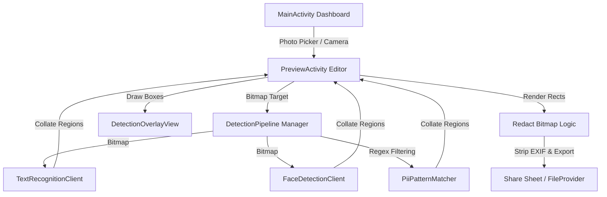

# ZenScan Project Context

> [!IMPORTANT]
> **DEVELOPER AGENT ACTION REQUIRED:**
> - **Startup Protocol**: Read this file first before taking any action. Align your focus with the **Active Task** and **Roadmap** sections. Adhere strictly to the **Development Guidelines**.
> - **Feature Completion Protocol**: Once a task or feature is finished, immediately update this file before ending your turn. Update the status of features, document changes in the **Session Audit & Change Log**, and advance the **Active Task** section.

---

## 1. Project Identity

**ZenScan** is a modern, privacy-first Android utility application designed to protect user privacy. It enables users to easily redact sensitive information (Personal Identifiable Information or PII, credit card numbers, faces) and clean EXIF metadata from screenshots, documents, and photos before sharing.

### Core Value Proposition
- **On-Device Only**: Zero networks. All scanning, face detection, text recognition, and redaction happen locally using Google ML Kit.
- **Secure Export**: Metadata is stripped and redacted pixels are rendered directly into new compression targets, ensuring no original details can be recovered.
- **Frictionless UI**: Modern Material 3 dashboard, visual photo picking, instant scan results with interactive overlay toggle, and quick share sheet integration.

---

## 2. System Architecture & Tech Stack

### Key Package Directory & Absolute Path Links
- **Core Activities**:
  - [MainActivity.kt](file:///home/sanjeev/AndroidStudioProjects/Realsanjeev/app/src/main/java/com/example/zenscan/MainActivity.kt) - Entry point; coordinates photo picking and dashboard clicks.
  - [PreviewActivity.kt](file:///home/sanjeev/AndroidStudioProjects/Realsanjeev/app/src/main/java/com/example/zenscan/PreviewActivity.kt) - The main workspace; handles loaded image lifecycle, undo stack, rendering, and export.
- **AI Detection Engine (`/detection`)**:
  - [DetectionPipeline.kt](file:///home/sanjeev/AndroidStudioProjects/Realsanjeev/app/src/main/java/com/example/zenscan/detection/DetectionPipeline.kt) - Coordinates OCR and face detection engines concurrently.
  - [FaceDetectionClient.kt](file:///home/sanjeev/AndroidStudioProjects/Realsanjeev/app/src/main/java/com/example/zenscan/detection/FaceDetectionClient.kt) - Wraps Google ML Kit Face Detector.
  - [TextRecognitionClient.kt](file:///home/sanjeev/AndroidStudioProjects/Realsanjeev/app/src/main/java/com/example/zenscan/detection/TextRecognitionClient.kt) - Wraps Google ML Kit Text Recognizer.
  - [PiiPatternMatcher.kt](file:///home/sanjeev/AndroidStudioProjects/Realsanjeev/app/src/main/java/com/example/zenscan/detection/PiiPatternMatcher.kt) - Regex rules and Luhn algorithm validations for PII (emails, cards, phones).
- **Models**:
  - [DetectedRegion.kt](file:///home/sanjeev/AndroidStudioProjects/Realsanjeev/app/src/main/java/com/example/zenscan/model/DetectedRegion.kt) - Houses data classes for found text blocks and faces.
- **Views**:
  - [DetectionOverlayView.kt](file:///home/sanjeev/AndroidStudioProjects/Realsanjeev/app/src/main/java/com/example/zenscan/view/DetectionOverlayView.kt) - A high-performance custom Canvas view displaying bounding boxes with modern animations and badges.

### Tech Stack Specifications
- **Framework & UI**: XML Layouts using Android Material 3 and ViewBinding.
- **Jetpack Libraries**: lifecycle-runtime-ktx, lifecycle-viewmodel-ktx, activity-ktx, navigation.
- **AI Engines**: Google ML Kit (Text & Face).
- **Image Loading**: Coil (Coil image loading engine for Kotlin/Android).
- **Asynchrony**: Kotlin Coroutines (Dispatchers.Default for AI processing, Dispatchers.IO for storage/image loads, Dispatchers.Main for UI updates).

---

## 3. Development Guidelines & Platform Rules

To maintain high standards, developer agents must follow these absolute rules:

### A. Android Jetpack & Styling Best Practices
- **ViewBinding**: Always inflate and bind layouts using native ViewBinding. Never call `findViewById` directly.
- **Material 3 Design**: Use M3 components (e.g. `MaterialButton`, modern `Toolbar`, rounded badges). Prefer curated, premium HSL tailored colors (like Indigo, Emerald, Rose-red) over primary default values.
- **Resource Extraction**: Maintain clean string, color, and dimension values in `res/values/` files (e.g., `strings.xml`, `colors.xml`). Do not hardcode dimensions or strings in Kotlin or XML files.

### B. On-Device AI & Privacy Architecture
- **Strict Privacy**: Under no circumstances should user photos or PII leave the device. Do not integrate network dependencies or external telemetry targets unless authorized by the project plan.
- **Thread Management**: AI operations (ML Kit calls, pattern regex matches) and bitmap modifications (redaction rendering, metadata stripping) must occur off the Main thread using `Dispatchers.Default` or `Dispatchers.IO`.

### C. RAM-Safe Bitmap and Undo-Stack Handling
- **Out of Memory (OOM) Protection**: Bitmaps consume massive amounts of heap space. Ensure all intermediate bitmaps are recycled or handled in coroutines where garbage collection can sweep them up.
- **History Limits**: The `historyStack` in `PreviewActivity` must never exceed a depth of 15 states to keep memory profiles stable. When copying bitmaps for the undo stack, capture copies safely and catch `OutOfMemoryError` gracefully.
- **Resource Cleanups**: Always close detection clients (e.g. `TextRecognizer`, `FaceDetector`) in `onDestroy` or when the engine is cleared to avoid serious system leaks.

---

## 4. Roadmap & Status

### Phase 1: Infrastructure & Setup 🟢 (Completed)
- Configured dependencies (`build.gradle.kts`) and added ML Kit models.
- Set up permissions handling for modern API targets.
- Created `MainActivity` dashboard layout.
- Integrated standard Photo Picker API for secure file loading.

### Phase 2: Smart Scan AI Engine 🟢 (Completed)
- Built `TextRecognitionClient` and `FaceDetectionClient`.
- Implemented `PiiPatternMatcher` with regex rules for phone, email, and credit card numbers.
- Implemented `DetectionPipeline` to orchestrate parallel OCR and face scanning.

### Phase 3: Interactive Redaction UI 🟡 (In Progress)
- [x] Dedicated [PreviewActivity.kt](file:///home/sanjeev/AndroidStudioProjects/Realsanjeev/app/src/main/java/com/example/zenscan/PreviewActivity.kt) layout with loaded image and toolbars.
- [x] High-performance [DetectionOverlayView.kt](file:///home/sanjeev/AndroidStudioProjects/Realsanjeev/app/src/main/java/com/example/zenscan/view/DetectionOverlayView.kt) drawing bounding boxes with rounded corner badges.
- [x] Safe Undo Stack handling up to 15 copies.
- [ ] Tap-to-toggle redactions on individual bounding boxes. (Pending)
- [ ] Manual brush drawing tool. (Pending)

### Phase 4: Secure Export & Sharing 🟢 (Completed)
- Rendered solid black redaction blocks directly onto bitmaps.
- Compressed images to high-quality JPEG to strip all EXIF metadata.
- Implemented secure Android Share Sheet integration via `FileProvider`.

---

## 5. Active Task

We have **established the Developer Agent Workflow and compiled the 7 Developer Skill reference manuals** in the `.agents/` folder. The development workspace is now fully initialized and documented for future coding tasks (e.g. Phase 3 interactive redactions toggles).

---

## 6. Session Audit & Change Log

| Date | Task / Change Description | Affected Files | Status |
| :--- | :--- | :--- | :--- |
| 2026-05-20 | Created standard `PROJECT_CONTEXT.md` to establish project identity, architecture patterns, and constraints. | [PROJECT_CONTEXT.md](file:///home/sanjeev/AndroidStudioProjects/Realsanjeev/PROJECT_CONTEXT.md) | Completed |
| 2026-05-20 | Created `PROJECT_CONTEXT_WORKFLOW.md` to define strict startup, execution, and finishing rules for agent pair-programming sessions. | [PROJECT_CONTEXT_WORKFLOW.md](file:///home/sanjeev/AndroidStudioProjects/Realsanjeev/PROJECT_CONTEXT_WORKFLOW.md) | Completed |
| 2026-05-20 | Created 7 detailed developer skill manuals documenting Android APIs, ML Kit Vision, Graphics/Canvas math, Coroutines, Memory recycling, Luhn checks, and FileProviders. | [SKILL.md (all 7 skills)](file:///home/sanjeev/AndroidStudioProjects/Realsanjeev/.agents/) | Completed |
