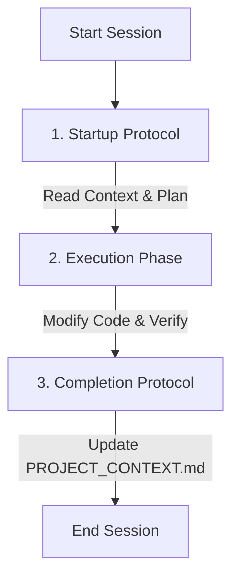

# ZenScan Developer Agent Workflow Guidelines

This document defines the strict operational protocols and workflow that **developer agents** must follow when working on the **ZenScan** project. Adhering to these guidelines ensures a high level of code quality, absolute privacy, and that the project documentation stays in lockstep with codebase reality.

---

## The Workflow Loop



---

## Phase 1: The Startup Protocol (MANDATORY FIRST STEP)

When a developer agent initializes or receives a new user instruction, it **must not** begin editing code immediately. Instead, it must complete the following steps:

1. **Locate and Read the Context**:
   Verify the existence of and read the [PROJECT_CONTEXT.md](file:///home/sanjeev/AndroidStudioProjects/Realsanjeev/PROJECT_CONTEXT.md) file at the root. This is the single source of truth for the project.
2. **Align on the Active Task & Roadmap**:
   Read Section 5 (**Active Task**) and Section 4 (**Roadmap & Status**) of the context to understand exactly where the last agent left off.
3. **Review Development Guidelines**:
   Internalize Section 3 (**Development Guidelines & Platform Rules**) including view-binding patterns, MVVM standards, RAM-safe bitmap controls, and local-only AI rules.
4. **Inspect the Active Directory**:
   Run a workspace scan using listing tools to ensure the codebase matches the context mapping before executing the first code block.

---

## Phase 2: The Execution Guidelines

During active code generation or modifications, agents must prioritize visual excellence, performant logic, and clean design patterns:

### A. Coding Standards
- **Kotlin**: Keep methods small and modular. Utilize functional styles where appropriate (e.g. `let`, `apply`, `run`, `use` for streams). Use Kotlin Coroutines on appropriate Dispatchers (`Dispatchers.Default` for heavy calculations like AI and bitmap rendering, `Dispatchers.IO` for file reads/writes, `Dispatchers.Main` for UI).
- **XML Layouts**: Use ConstraintLayout for complex layouts to keep view hierarchies flat and performant. Keep layout dimensions and strings neatly extracted into resources (`strings.xml`, `colors.xml`, `dimens.xml`).

### B. High-End UI Aesthetics (Premium Visuals)
- **Harmonious Palette**: Adhere to premium theme colors:
  - **PII Alerts**: Rose-red (`#F43F5E`) at `12%` alpha for bounding fills, solid outline for stroke highlights.
  - **Face Alerts**: Indigo (`#6366F1`) at `12%` alpha for bounding fills, solid outline for stroke highlights.
  - **Accent Accents**: Sleek Dark Modes and Glassmorphism effects with backdrop-filters where appropriate.
- **Micro-Animations**: Add soft transition reveals when bounding boxes are drawn, using alpha fades or scale transitions. Ensure toolbars, progress overlays, and badges have clean layouts and smooth click responses.

### C. Resource and Memory Safeguards
- **Undo Limits**: Restrict history stack sizes to a maximum of 15 states. Recovers unused bitmap memory promptly via `bitmap.recycle()`.
- **Pipeline Resource Releases**: Ensure ML Kit detector instances are closed cleanly in `onDestroy` of Activities or Fragments.

---

## Phase 3: The Completion Protocol (MANDATORY CLOSING STEP)

Before finishing a session or submitting work to the user, the agent must perform the following validation and synchronization tasks:

### 1. Compile & Verify
- Proactively run Gradle builds or verification tests to ensure that the code compiles perfectly without syntax or layout errors:
  ```bash
  ./gradlew compileDebugSources
  ```

### 2. Update `PROJECT_CONTEXT.md`
The task is **never** complete without updating the central context file. The agent must:
- Update the progress checklist in **Section 4 (Roadmap & Status)** (e.g. marking items as completed `[x]`, in progress `[/]`, or updated).
- Update **Section 5 (Active Task)** to point to the next logical step or mark the current task as ready for verification.
- Add an entry to the table in **Section 6 (Session Audit & Change Log)** including the current date, a concise change description, files edited, and completion status.

### 3. Generate the Walkthrough
- Create or update the [walkthrough.md](file:///home/sanjeev/.gemini/antigravity-ide/brain/21f62831-df8d-4d56-8aa3-8293815c1c62/walkthrough.md) artifact, detailing what was accomplished, what changed, how it was tested, and highlighting links to files that were created or modified.
